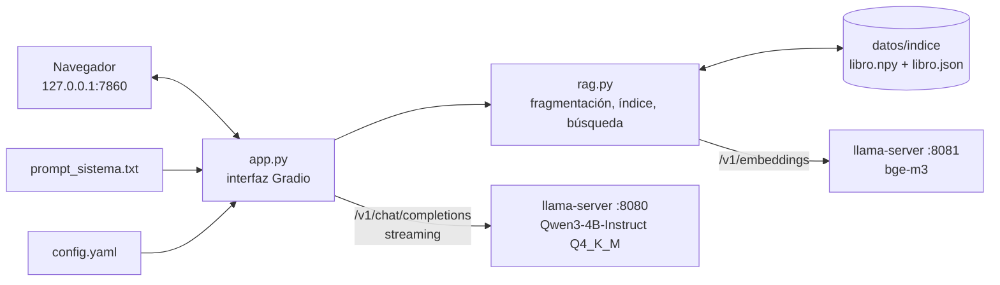

# 🎓 portaTutor-RAG

Asistente de IA **local y portable** que orienta procesos de reingeniería a partir del libro de *Reingeniería de Procesos para Sistemas de Información* (Escobar, Santillán Escudero y Silva, UNLaR, ed. 2026).

Corre desde un pendrive, **offline** y sin instalar nada en la computadora. Usa RAG (*Retrieval-Augmented Generation*): ante cada consulta busca los fragmentos relevantes del libro y se los entrega a un modelo de lenguaje que se ejecuta en la propia máquina.


## ✨ Características

- **100 % offline**: el modelo, el índice y la interfaz corren en `127.0.0.1`.
- **Portable**: rutas relativas a la raíz del pendrive; incluye Python y `llama-server` para Windows y Linux.
- **Citas verificables**: al pie de cada respuesta, el programa (no el modelo) agrega los fragmentos usados con capítulo, sección y número de página impreso.
- **Libro e inferencia separados**: cada respuesta distingue **📖 Según el libro** de **💡 Inferencia / recomendación**.
- **Guía en 7 fases** (delimitación, AS-IS, diagnóstico, TO-BE, aporte de SI/IA, indicadores, plan de implementación), con validación del usuario al cerrar cada una.
- **Reconoce información insuficiente**: si ningún fragmento supera el umbral de similitud, lo informa y no cita el libro.
- **Registro de conversaciones** en `registros/` con un botón.

## 🏗️ Arquitectura

El sistema son tres procesos locales:



| Proceso | Puerto | Función |
|---|---|---|
| `llama-server` (chat) | 8080 | Modelo de lenguaje `modelos/llm.gguf`. API compatible con OpenAI, con streaming. |
| `llama-server` (embeddings) | 8081 | Modelo `modelos/embeddings.gguf` con `--embedding --pooling cls`. Así los embeddings no se calculan en Python y no hace falta PyTorch. |
| `app/app.py` | 7860 | Interfaz web Gradio que orquesta la búsqueda y la generación. |

### 📚 Indexación del libro (`app/indexar.py` + `app/rag.py`)

1. **Fragmentación**: el libro en Markdown se divide por encabezados `#`–`###`, en ventanas de unas 400 palabras con 60 de superposición. Las secciones muy cortas se unen a la siguiente. Cada fragmento lleva una etiqueta del tipo `Cap. 2 > Casos emblemáticos > IBM Credit Corporation`.
2. **Asignación de páginas**: el `.md` es una versión editada del PDF, así que se buscan frases de 6 palabras de cada fragmento en el texto de cada página (extraído con PyMuPDF) y se vota la página más probable. Si no hay coincidencia, se cita un rango (`pp. X–Y`) según los fragmentos vecinos. Se cita el número **impreso** de la página; las páginas sin número impreso salen como `p. N del PDF`.
3. **Embeddings**: se calculan una sola vez y se guardan normalizados en `datos/indice/libro.npy`, con los fragmentos en `libro.json`.

### 🔄 Flujo de una consulta (`responder` en `app/app.py`)

1. La consulta de búsqueda es el último mensaje del usuario; si tiene menos de 12 palabras, se le suma el mensaje anterior.
2. Se recuperan los `top_k` fragmentos más similares (producto punto más un refuerzo léxico para nombres propios) y se insertan, rotulados `[L1]`, `[L2]`…, en el último mensaje que recibe el modelo.
3. Si ningún fragmento supera el umbral, igual se consulta al modelo, pero con la orden de no citar el libro. Así no se traba el relevamiento, en el que el usuario describe su propio proceso.
4. Se descartan los mensajes más viejos del historial hasta que el turno entre en la ventana de contexto.
5. El programa agrega las citas al pie y las quita antes de reenviar el historial al modelo.

El comportamiento del tutor (fases, bloques 📖/💡, validaciones) está definido en `app/prompt_sistema.txt`.

### 📂 Estructura del repositorio

```
portaTutor/
├── iniciar.sh / iniciar.bat   levanta los dos servidores y la app (Linux / Windows)
├── preparar.sh                descarga binarios de python
├── app/
│   ├── app.py                 
│   ├── rag.py                 
│   ├── indexar.py             
│   ├── config.yaml            
│   ├── prompt_sistema.txt     
│   └── requirements.txt       
├── datos/
│   ├── ReingenieriaProcesos-…-Libro.md    texto que se fragmenta
│   ├── ReingenieriaProcesos-…-Libro.pdf   se usa para asignar páginas
│   └── indice/                
├── pruebas/prueba_funcional.py  
├── LICENCIAS/                 
├── MANUAL.md                  manual para el usuario final
├── etapa_c.md                 
│
├── bin/        
├── python/     
├── modelos/    
└── registros/  
```

## 🧰 Tecnologías

| Pieza | Tecnología | Versión |
|---|---|---|
| Motor de inferencia | [llama.cpp](https://github.com/ggml-org/llama.cpp) (`llama-server`) | `b12192` |
| Modelo de lenguaje | [Qwen3-4B-Instruct-2507](https://huggingface.co/Qwen/Qwen3-4B-Instruct-2507), GGUF Q4_K_M | — |
| Modelo de embeddings | [bge-m3](https://huggingface.co/BAAI/bge-m3), GGUF Q8_0 | — |
| Lenguaje | Python ([python-build-standalone](https://github.com/astral-sh/python-build-standalone)) | 3.12.16 |
| Interfaz | Gradio | 6.31.0 |
| Cliente HTTP | httpx | 0.28.1 |
| Cálculo vectorial | NumPy | 2.5.4 |
| Lectura del PDF | PyMuPDF | 2.1 |
| Configuración | PyYAML | 6.0.3 |
| Gestor de paquetes (preparación) | [uv](https://docs.astral.sh/uv/) | — |
| Scripts de inicio | Bash y Batch | — |

## 🛠 Requisitos

**Requisitos minimos**

- CPU de 64 bits (x86-64) y **8 GB de RAM** como mínimo.
- Windows 10/11 o GNU/Linux con glibc 2.35 o superior.

**Para prepararlo** (una sola vez)

- Linux con conexión a Internet.
- `uv`, `curl`, `tar` y `unzip`.
- Unos 4 GB libres (la descarga ronda los 3,5 GB).
- Opcional: pendrive USB 3.0 de 32 GB o más, formateado en **exFAT** para que funcione en Windows y Linux.

## 🚀 Instalación

1. Clonar el repositorio:

   ```bash
   git clone https://github.com/SoreireLautaro/PortaTutorRAG.git
   cd portaTutor
   ```

2. Descargar binarios, Python portable, librerías y modelos:

   ```bash
   bash preparar.sh            # Ejecutar en Linux y Windows
   bash preparar.sh linux      # Ejecutar solo Linux
   bash preparar.sh windows    # Ejecutar solo Windows
   ```

   El script deja `llama-server` en `bin/<so>/`, Python con las librerías de `app/requirements.txt` en `python/<so>/` y los modelos en `modelos/`. Las librerías de Windows se instalan desde Linux con `uv pip install --python-platform x86_64-pc-windows-msvc`.

3. *(Opcional)* Copiar la carpeta completa a la raíz del pendrive. exFAT no admite enlaces simbólicos, así que conviene copiar con `cp -rL`.

## ▶️ Ejecución

| Sistema | Cómo iniciar |
|---|---|
| Linux | `bash iniciar.sh` |
| Windows | doble clic en `iniciar.bat` |

El script levanta los dos `llama-server`, espera a que respondan, genera el índice del libro si todavía no existe y abre el navegador en **http://127.0.0.1:7860**. La primera ejecución tarda más por la indexación. Si 8080, 8081 o 7860 están ocupados, el script elige puertos libres automáticamente y muestra la URL real.

Para salir: `Ctrl+C` en la terminal (Linux) o cerrar la ventana (Windows). En Linux, la salida de los servidores queda en `llm.log` y `embeddings.log`.

La guía de uso para el usuario final está en [MANUAL.md](MANUAL.md).

## 💻 Desarrollo

Sin el Python portable se puede trabajar con `uv`. Para no repetir la línea larga:

```bash
alias py='uv run --no-project --python 3.12 --with-requirements app/requirements.txt python'
```

```bash
# Ver la fragmentación y la asignación de páginas (no necesita los servidores)
py app/indexar.py --solo-fragmentar

# Con los servidores en marcha:
py app/indexar.py                          # regenerar el índice
py app/indexar.py --probar "pregunta"      # ver la similitud de los mejores fragmentos
py pruebas/prueba_funcional.py --casos A,B,C   # prueba de punta a punta; escribe en registros/
```

No hay tests unitarios ni linter configurado.

## ⚙️ Configuración

Todo se ajusta en [`app/config.yaml`](app/config.yaml). Las rutas son relativas a la raíz del proyecto.

| Clave | Valor por defecto | Para qué sirve |
|---|---|---|
| `libro.markdown` / `libro.pdf` | `datos/…-Libro.md` / `.pdf` | Fuente del índice y de los números de página |
| `indice.palabras_por_fragmento` | 400 | Tamaño de cada fragmento |
| `indice.superposicion` | 60 | Palabras compartidas entre fragmentos consecutivos |
| `busqueda.top_k` | 5 | Fragmentos que se recuperan por consulta |
| `busqueda.umbral` | 0.55 | Similitud mínima para considerar relevante un fragmento |
| `busqueda.peso_lexico` | 0.15 | Refuerzo para palabras poco frecuentes de la consulta |
| `generacion.temperatura` | 0.4 | Creatividad del modelo |
| `generacion.max_tokens` | 1500 | Largo máximo de cada respuesta |
| `generacion.contexto_tokens` | 8192 | Ventana de contexto |
| `interfaz.puerto` | 7860 | Puerto de la interfaz web |

Cuidados al cambiar la configuración:

- `generacion.contexto_tokens` debe coincidir con el `-c` de `llama-server` en `iniciar.sh` **e** `iniciar.bat`.
- Si se cambia el modelo de embeddings, hay que ajustar `--pooling` en los dos scripts, los prefijos de `embeddings` en `config.yaml` (por ejemplo, multilingual-e5 usa `query: ` y `passage: `) y regenerar el índice.
- Si se cambia el libro, hay que regenerar el índice.
- `iniciar.bat` debe conservar los finales de línea CRLF (lo garantiza `.gitattributes`). Si se edita desde Linux, verificarlo con `file iniciar.bat`.

## 🩺 Solución de problemas

| Síntoma | Causa probable y solución |
|---|---|
| `Falta bin/…/llama-server` o `Falta modelos/…` | No se ejecutó `preparar.sh` o la copia al pendrive quedó incompleta. |
| `El servidor de llm no arrancó` | Ver `llm.log`. Suele ser falta de RAM: cerrar otros programas. |
| `Permission denied` en Linux | exFAT pierde los permisos de ejecución: iniciar con `bash iniciar.sh`, que los restablece. |
| La interfaz no abre | Escribir la URL que muestra el script a mano (si 7860 está ocupado, el script usa un puerto libre), o cambiar `interfaz.puerto`. |
| Respuestas muy lentas | En equipos sin placa de video cada respuesta tarda entre 10 y 30 segundos. |
| Responde que no encontró fragmentos | Probar la consulta con `indexar.py --probar` y, si hace falta, bajar `busqueda.umbral`. |

## ⚠️ Limitaciones

- El modelo es pequeño (4 mil millones de parámetros): puede equivocarse o resumir mal un fragmento. Las citas importantes deben verificarse contra el libro.
- El libro es la **única** fuente de conocimiento: no consulta otros documentos ni Internet.
- La decisión final siempre es del usuario.

## 📄 Documentación

- [MANUAL.md](MANUAL.md): manual para el usuario final.
- [LICENCIAS/LEEME.md](LICENCIAS/LEEME.md): licencias de los componentes.

## 📝 Licencias y créditos

Los componentes de terceros conservan sus licencias: llama.cpp (MIT), Qwen3-4B-Instruct-2507 (Apache 2.0), bge-m3 (MIT), Python (PSF), Gradio, NumPy, httpx y PyYAML (Apache 2.0 / BSD / MIT) y PyMuPDF (AGPL-3.0). El detalle está en [LICENCIAS/LEEME.md](LICENCIAS/LEEME.md).


Proyecto desarrollado para la materia Inteligencia Artificial, Ingeniería en Sistemas de Información, Universidad Nacional de La Rioja.
